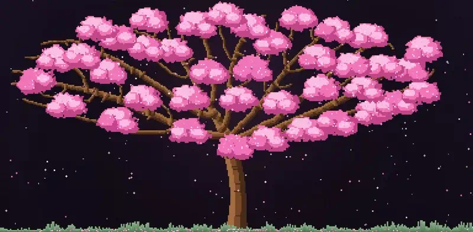
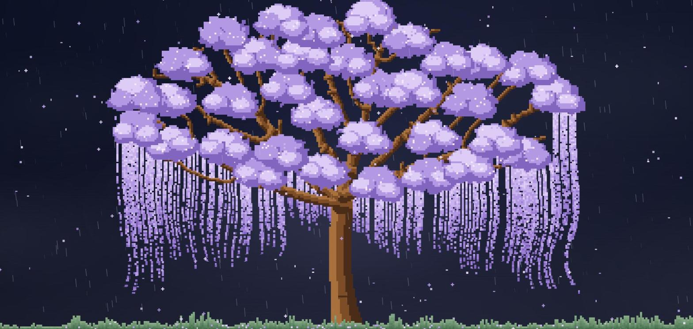
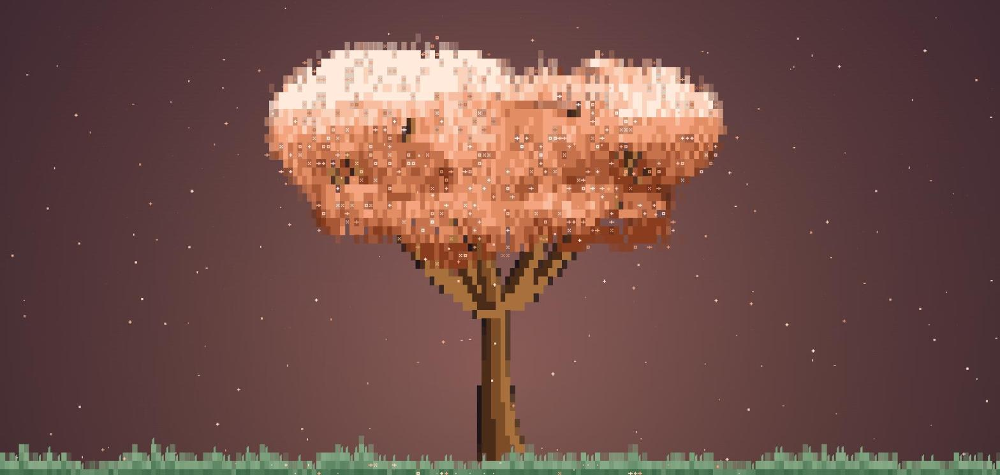
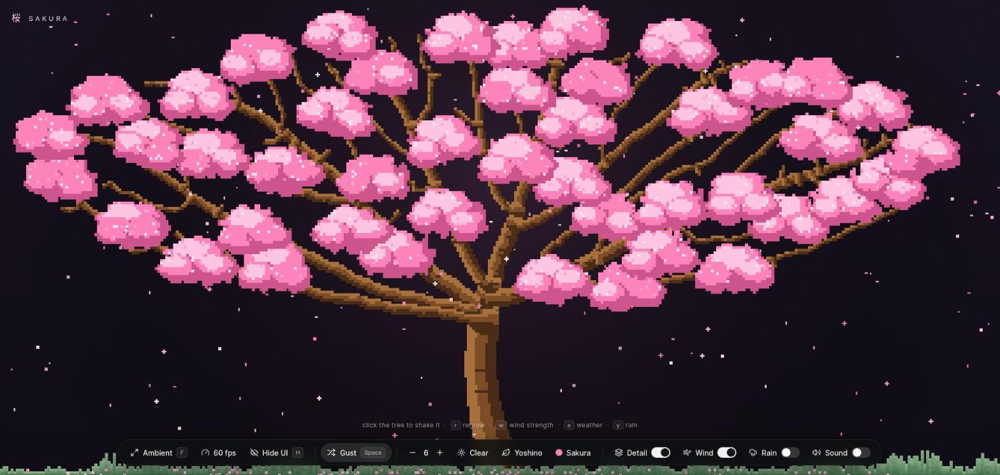

# Sakura 桜 🌸

A calm, procedurally grown cherry blossom tree. Petals fall from the crown, drift on a wandering
wind, settle in the grass and fade. The tree is different every time you regrow it.

Plain TypeScript and Canvas 2D, **no runtime dependencies**. The JavaScript is about 17 KB gzipped
(15 KB with brotli), and the whole page, HTML and CSS included, is about 20 KB.

<p align="center">
  
</p>

| Weeping cherry, moonlight and rain | Cell mode, sunset |
| --- | --- |
|  |  |

## Features

- **Two looks.** *Cell mode* is blocky, in the style of a terminal. *Detail mode* is a fully
  branched pixel tree whose limbs fork and taper into twigs.
- **Three kinds of cherry:** yoshino (spreading), bush (a full, rounded cloud) and shidare
  (weeping), or a random one on every regrow. No two trees are alike.
- **Alive.** Petals sway and tumble as they fall. Blossom clusters ripple at random spots, and the
  weeping strands wave. Click or drag on the tree to shake blossom loose and send ripples through it.
- **Wind** that wanders and gusts. Switch it off and the strands hang still and petals fall straight.
- **Weather** that stays in the sky: clear, sunset, moonlight, overcast and mist, plus a rain switch
  that works on top of any of them. The tree and grass stay crisp in every weather.
- **12 blossom colours,** from sakura pink to lavender, mint and gold.
- **Ambient mode** for use as a wallpaper: fullscreen, with the controls fading away when idle, and a
  frame-rate limit (24 / 30 / 45 / 60, with a live fps readout) to keep it light.
- **Synthesised sound** (wind, rain and a soft chime on click). No audio files, and nothing loads
  until you switch it on.
- **Works on a phone.** The controls collapse into a round menu button and open as a bottom panel.
- **A pointer that matches.** The cursor over the scene is a small arrowhead in the colour of the
  blossom you picked.
- Settings are remembered. It respects `prefers-reduced-motion`.

## Run it

```bash
npm install
npm run dev       # http://localhost:5173
npm run build     # type-check and build the site into dist/
npm run preview   # serve the built site locally
```

Node 20 or newer is recommended.

## Controls

Everything is in the bar at the bottom: Ambient, a live fps readout (click it to limit the frame rate), Minimise, a Gust button, dropdowns for
weather, tree form and blossom colour, and switches for Detail, Wind, Rain and Sound. Minimise tucks
the bar away into a round menu button in the bottom right corner; tap it to bring the bar back, or
drag it anywhere you like (it remembers where).

On a phone the controls start minimised so they never cover the tree. Tap the round button to open
them as a panel across the bottom; it closes itself a few seconds after your last touch, and tapping
the tree tucks it away too.



The keyboard works as well:

| Key | Does |
| --- | --- |
| click / tap | shake blossom loose and send a gust through the air; on the blossom and the weeping strands it also sends a ripple rolling through them. Drag to sweep petals along |
| `space` | gust of wind |
| `f` | Ambient mode: fullscreen, and the controls fade away after a couple of idle seconds (move to bring them back, `Esc` to leave) |
| `r` | regrow the tree (a new shape every time) |
| `s` | tree form: yoshino, bush, shidare, random |
| `c` / `C` | next / previous blossom colour |
| `d` | detail mode on / off |
| `p` / `P` | more / fewer petals (1 to 10) |
| `a` | wind on / off |
| `w` / `W` | more / less wind |
| `e` / `E` | next / previous weather |
| `y` | rain on / off |
| `m` | sound on / off |

## Deploy

It is a static site, so any static host works.

**Vercel:** import the repository. The Vite defaults are right (build command `npm run build`,
output directory `dist`).

The build uses relative asset paths (`base: "./"` in `vite.config.ts`), so the same output also works
when served from a sub-folder, such as GitHub Pages at `/<repo>/`.

## How it works

Everything is rule-based; nothing is a recorded animation.

| File | What it does |
| --- | --- |
| `src/tree.ts` | Cell mode. A trunk of tapered slices, limbs drawn as curves, then a canopy grown from a field of blobs at the limb tips, broken into clumps with value noise, shaded from the upper left and dotted with blossoms. Each form draws its proportions, lean and limbs from ranges. |
| `src/treehd.ts` | Detail mode. Branches grown by *space colonisation* (attraction points fill the crown and the tree grows toward them), thickness from a pipe model, blossom as layered bundles. |
| `src/grid.ts`, `src/render.ts` | The tree is a grid of cells painted once onto a transparent canvas. Cells on the outline fade into whatever sky is behind them. |
| `src/petals.ts`, `src/wind.ts` | Petals fall from the blossom with sway and tumble, catch a wandering wind plus gusts, lie on the ground for a few seconds and fade. |
| `src/sway.ts` | The moving parts of the tree live on their own layers: the blossom clusters (random local ripples) and the hanging strands (a wave that travels down each one). Each frame a layer is drawn a band of rows at a time, every column shifted sideways by its own amount. |
| `src/weather.ts`, `src/rain.ts` | Each weather is a "look" (tint, sky veil, light, clouds, fog, rain, wind and petal-fall multipliers) drawn as overlays on the sky behind the tree. Changing weather eases every number, so nothing is regrown. Rain streaks lean with the wind and splash in the grass. |
| `src/audio.ts` | Wind, rain and chimes, all synthesised with the Web Audio API. |
| `src/main.ts` | Wiring: layout, the control bar, ambient mode, the frame loop. |

## Credits

- **[csakura](https://github.com/realstrawhat/csakura)** by realstrawhat (MIT) is the inspiration
  for the look, and Sakura's tree generation follows its approach: tree forms drawn from ranges, a
  canopy grown from blobs at the limb tips, and space-colonisation branching in detail mode.
  The code here was written from scratch. Its licence notice is in [NOTICE.md](NOTICE.md).
- **[nagomi](https://github.com/msk1039/nagomi)** by Mayank Kadam inspired the idea of a calm,
  procedural scene with weather and a single control bar. No code from it is used.

## License

No licence has been chosen for this project yet, so all rights are reserved for now.
Third-party notices are in [NOTICE.md](NOTICE.md).
